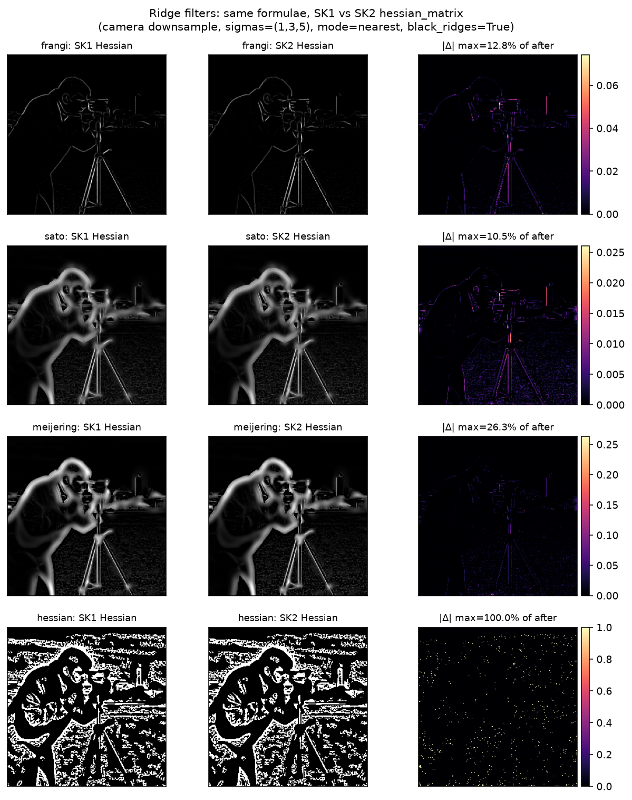
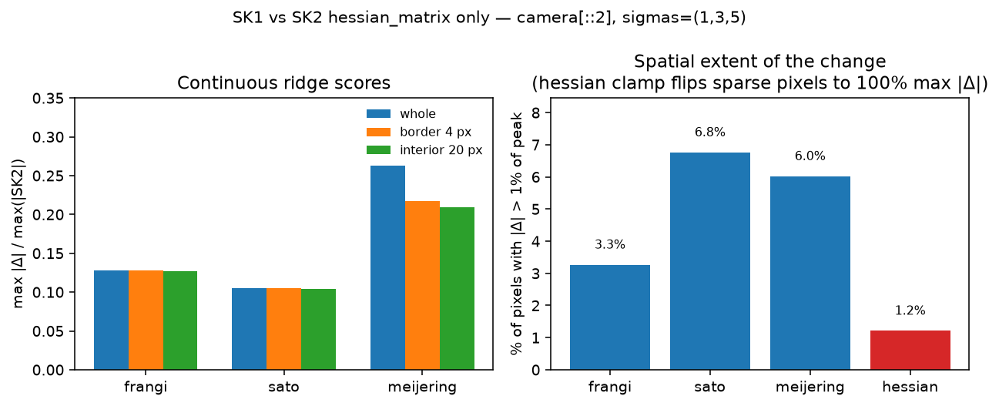
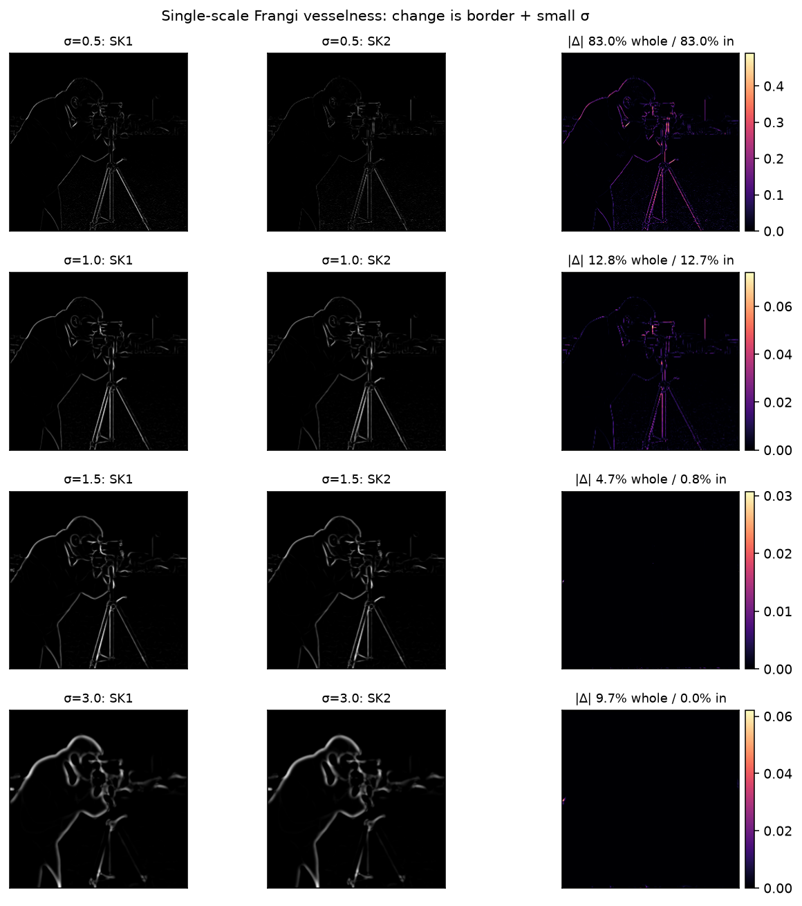

# Refactoring plan: `structure_tensor` and `hessian_matrix`

This plan covers the SK2 Hessian implementation and how the ridge filters
consume it. Companion measurements: `skimage-workbooks` notebooks
`on_hessian.md`, `hessian_review.md`, `hessian_testing.md`. Frangi algorithm
defects are in `frangi_refactor_plan.md` / `on_frangi.md`.

Figures below were measured on the `hessian-refactor` worktree: SK1 ridge
formulae calling the legacy two-pass `hessian_matrix`, versus the same
formulae calling the SK2 one-pass operator
(`figures/hessian_refactor/`, camera image downsampled by 2).

## 1. Revised proposal

**Fix `hessian_matrix` in SK2, and have the ridge filters call that operator
directly — after (or together with) the already-breaking Frangi fixes.**

Earlier drafts kept SK1 ridge numerics frozen by copying `frangi` / `sato` /
`meijering` / `hessian` under `skimage.filters` so they still imported the
legacy Hessian. That copy is unnecessary once Frangi is allowed to change:

1. Frangi output will change for independent algorithm reasons (D1–D4, D6 in
   `frangi_refactor_plan.md`).
2. The Hessian fix (D5) changes all four ridge filters in a similar, mostly
   border- and small-σ pattern (Section 4).
3. SK2 must not grow APIs or private hooks whose only purpose is to serve the
   SK1 tree. Relative import of SK2’s own `hessian_matrix` is enough.

So the preferred SK2 shape is:

- `_skimage2.feature.hessian_matrix` — one-pass, moment-corrected operator.
- `_skimage2.filters.ridges` — single implementation; `from ..feature.corner
  import hessian_matrix` as today.
- No injectable Hessian parameters and no ridges fork inside SK2.

SK1 can keep a legacy `hessian_matrix` for direct callers (`shape_index`,
etc.) without also freezing the ridge module. Ridge filters either re-export
SK2 (accept the joint break) or stay on the old Hessian only if a separate
compatibility decision requires it — not because Frangi must stay bit-stable.

## 2. Scope

| API | after this work |
| --- | --- |
| `skimage.feature.hessian_matrix` | legacy two-pass path and arguments (SK1) |
| `skimage.feature.shape_index` | SK1 Hessian path |
| `_skimage2.feature.hessian_matrix` | one-pass moment-corrected implementation |
| `_skimage2.filters.{frangi,sato,meijering,hessian}` | call SK2 `hessian_matrix` directly |
| `skimage.filters` ridges | prefer re-export of SK2 after Frangi+Hessian land; optional SK1 freeze only if required |

Do not add Frangi polarity, scale normalisation, gamma hoisting, or
`noise_floor` policy in the Hessian PR. Those belong to the Frangi plan.

## 3. SK2 Hessian operator

`_skimage2.feature.hessian_matrix` should:

- accept scalar or per-axis `sigma`;
- compute every element with one pass per axis;
- use moment-corrected sampled Gaussian derivative kernels;
- apply the selected boundary rule once per axis;
- return elements in array-axis order;
- omit the SK1-only `order` and `use_gaussian_derivatives` parameters;
- return exact zeros for a constant image when the boundary rule preserves
  that constant.

Moment correction is tested on constants and quadratics. Small-σ behaviour is
part of the new operator contract, not a claim about the old operator.

SK1 `skimage.feature.corner` keeps the old implementation. Migration shims may
point at SK2 and offer `hessian_matrix_xy`, but must not route the old call to
the new operator.

## 4. How severe is the Hessian change for the other ridge filters?

All four filters share the same Hessian call. Frangi-only algorithm fixes do
**not** apply to Sato / Meijering / Hybrid Hessian unless those filters are
edited separately. What they inherit from a fixed Hessian is below.

### 4.1 Multi-scale default-like sweep

Same formulae, `sigmas=(1, 3, 5)`, `mode='nearest'`, `black_ridges=True`.
Left: SK1 Hessian. Middle: SK2 Hessian. Right: absolute difference.

Measured peak relative change (`max|Δ| / max(|SK2|)`):

| filter | whole | border (4 px) | interior (20 px in) |
| --- | --- | --- | --- |
| `frangi` | 12.8% | 12.8% | 12.7% |
| `sato` | 10.5% | 10.5% | 10.4% |
| `meijering` | 26.3% | 21.7% | 20.9% |
| `hessian` | 100%\* | 100%\* | 100%\* |

\*Hybrid `hessian` is `frangi` followed by `filtered[filtered <= 0] = 1`. Tiny
vesselness shifts flip sparse pixels between ~0 and 1, so the **peak** relative
error hits 100% even when only ~1% of pixels move by more than 1% of the peak.

**Reading:**

- **Frangi / Sato** — continuous scores move by ~10–13% at the peak under this
  sweep. Most of that is the **σ = 1** scale in the max-over-scales (see 4.2),
  not a uniform rewrite of the interior at every scale.
- **Meijering** — larger (~20–26%). It divides each scale by that scale’s
  **global max**, so border (and other) artefacts shift the normaliser and the
  interior can move even when the local Hessian interior is fine. Pad-once
  tests in `hessian_review.md` make Frangi / Sato / Hybrid Hessian exact after
  the Hessian fix; Meijering still shows a few-percent interior residue from
  this non-locality (`on_meijering.md`).
- **Hybrid `hessian`** — same Frangi vesselness underneath; the clamp makes
  peak metrics look catastrophic. Spatially, only a small fraction of pixels
  flip.

### 4.2 Single-scale Frangi: border vs small σ

| σ | whole | border | interior (20 px in) |
| --- | --- | --- | --- |
| 0.5 | 83.0% | 51.5% | 83.0% |
| 1.0 | 12.8% | 12.8% | 12.7% |
| 1.5 | 4.7% | 4.7% | 0.8% |
| 3.0 | 9.7% | 9.7% | 0.0% |

For **σ ≥ ~1.5**, the interior is nearly unchanged; the remaining whole-image
error is a **border band** (old values are wrong against a pad-once standard).
For **σ ≤ 1**, the interior moves as well, toward the analytic answer (shipped
kernels under-gain small-σ curvature). Default ridge sweeps start at σ = 1, so
users see border change plus a contribution from the smallest default scale.

Users who choose σ ≪ 1 see large interior corrections and higher noise gain
(a more accurate second-derivative operator reports noise more fully).

### 4.3 Severity verdict

| Audience | Hessian-only impact |
| --- | --- |
| Default `sigmas=range(1, 10, 2)` maps | Noticeable at the frame and at fine structure from σ = 1; not a full interior rewrite at large scales |
| Bit-stable ridge pipelines | Breaking for all four filters |
| Frangi already accepted as breaking | Sato / Meijering / Hybrid Hessian are **similar order**, Frangi-algorithm fixes extra on top for Frangi only |

**Practical conclusion for this plan:** once Frangi is allowed to break, freezing
Sato / Meijering / Hybrid Hessian on the old operator is weak value for a full
ridges copy. Prefer one SK2 ridges module on the fixed Hessian.

## 5. Why not inject Hessian into SK2 ridges?

Constraint: **nothing in the SK2 tree should betray the need for or presence of
the SK1 tree** (no SK1 imports, no “legacy Hessian” hooks whose reason is SK1).

That rules out clean shared-body designs that put `hessian_matrix=` injectors or
SK1-motivated factories in SK2. Options that remain:

1. **Re-export / single SK2 body** (preferred under Section 1) — SK2 unaware of
   SK1; numerics change.
2. **Full SK1 ridges copy** — SK2 stays clean; high maintenance; only justified
   if SK1 ridges must stay bit-stable while SK2 moves.
3. **SK1-only runtime rebinding** (patch / rewrite imports) — SK2 clean, but
   fragile; worse than an intentional copy.

With Frangi breaking accepted, choose (1).

## 6. Frangi relationship

Defects from the Frangi notebooks:

| | defect | owner |
| --- | --- | --- |
| D1 | wrong-polarity rejection | `frangi` |
| D2 | σ² scale normalisation (regression) | `frangi` |
| D3 | `gamma=None` / `sigmas` order | `frangi` |
| D4 | documented non-locality of image-derived `gamma` | docs |
| D5 | Hessian border / small-σ operator | `hessian_matrix` |
| D6 | `alpha` inert in 2-D | docstring |

D1, D3, D4, D6 do not depend on the Hessian implementation. D2’s measurements
should use the **final** SK2 Hessian. D5 is this plan.

Paper note: Frangi’s derivative normalisation exponent (`gamma_L`) is not the
same as the structuredness threshold `c` (API name `gamma`). D2 restores
`sigma**2` per the paper default γ = 1; see `frangi_refactor_plan.md`.

## 7. Pull requests and ordering

Preferred order under the revised proposal:

1. **Frangi correctness (breaking)** — D1, D3; document D4, D6; then D2 with
   announced behaviour change. May land on SK2 ridges that still call today’s
   Hessian, then rebase onto (2).
2. **SK2 Hessian (breaking for all ridge filters that import it)** — one-pass
   operator; SK2 ridges call it directly; SK1 `feature.hessian_matrix` stays
   legacy for direct callers.
3. **SK1 ridge policy** — default: re-export SK2 ridges after (1)+(2), with
   release notes covering Frangi + Hessian. Optional: keep an SK1 ridges copy
   on the legacy Hessian only if compatibility review requires it.

Do **not** finalise D2 measurements against the old Hessian and then silently
carry them onto the new one.

Older plan variants that required an SK1 ridges freeze *before* any Hessian
consumer change are superseded by Section 1.

## 8. Tests

### SK2 Hessian

1. Scalar and per-axis sigma agree when equal.
2. Constants → no measurable Hessian when the mode preserves constants.
3. Quadratics → known second derivatives in the interior.
4. Boundary rule applied once (pad-once reference).
5. Transpose maps tensor elements in reversed order.
6. SK2 ridge filters keep shape / dtype contracts on the new operator.
7. Doctests and migration text describe the changed API.

Do not use SK1 output as the SK2 oracle.

### Ridge consumers

- Document that SK2 `frangi` / `sato` / `meijering` / `hessian` follow the SK2
  Hessian (border + small-σ notes in release notes).
- Meijering: treat global-max normalisation as a separate issue; do not expect
  pad-once exactness after the Hessian fix alone.
- Hybrid `hessian`: avoid asserting peak relative equality across the clamp;
  prefer spatial or pre-clamp checks.

### SK1

- `skimage.feature.hessian_matrix` still accepts `order` and
  `use_gaussian_derivatives`.
- If SK1 ridges re-export SK2, migration tests should say so. If an SK1 freeze
  copy exists, assert it does **not** come from `_skimage2`.

## 9. Open decisions

1. Whether SK1 `filters.ridges` re-exports SK2 after the joint break, or keeps a
   legacy copy (discouraged unless required).
2. Whether SK1 ever receives Frangi algorithm fixes independently of re-export.
3. Meijering global-max policy (`on_meijering.md`) — separate from Hessian.
4. Any `noise_floor` on ridge filters — separate issue, not part of the Hessian
   refactor.
5. Frangi D2 exponent: paper `sigma**2` (preferred in `frangi_refactor_plan.md`)
   vs Lindeberg ridge-width calibration — decide in the Frangi plan, measure on
   the final SK2 Hessian.
